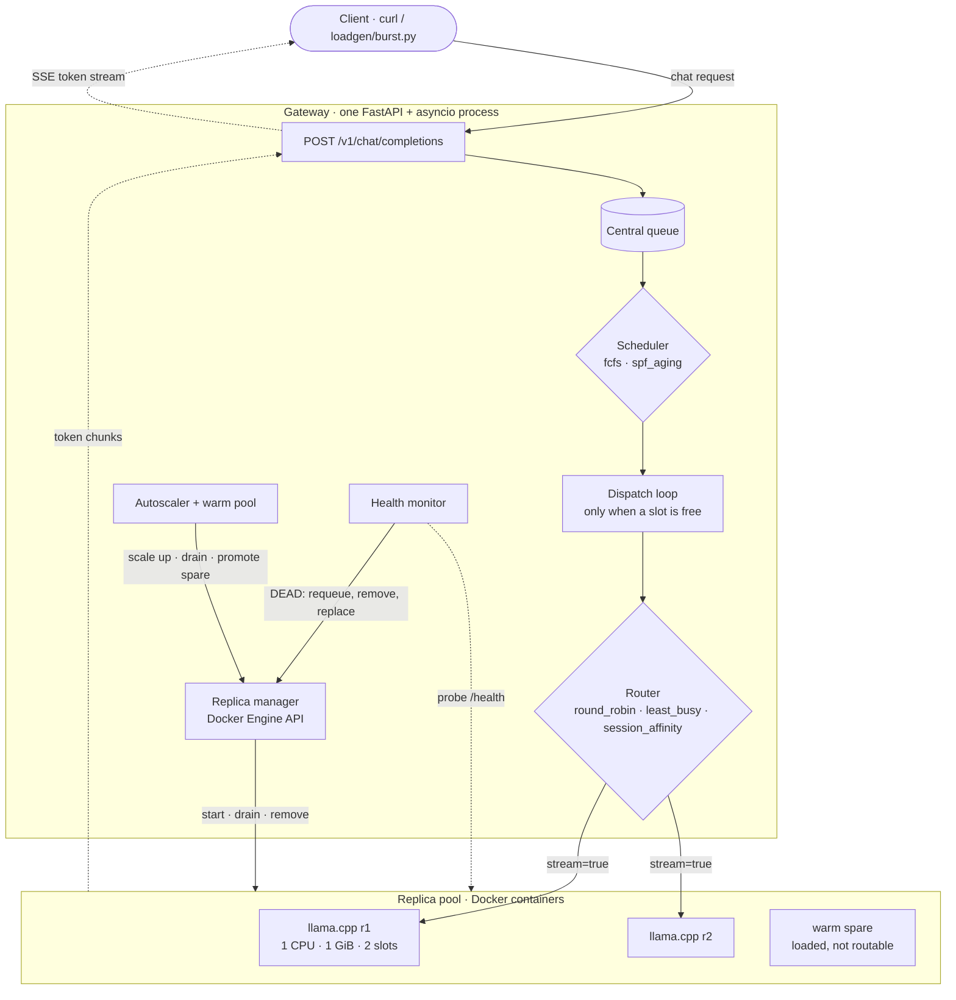
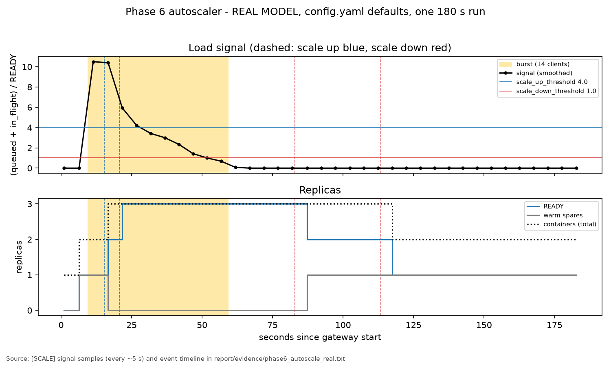
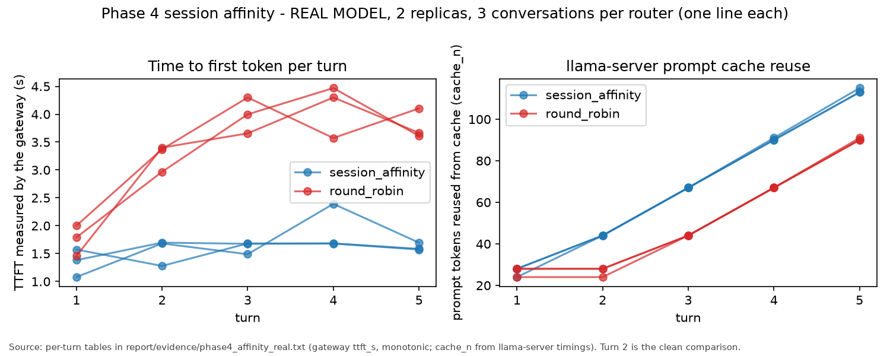

<div align="center">

# Elastic LLM Inference Gateway

**One queue, many replicas: a scheduling, routing and self-healing gateway for containerized local LLMs.**


[Architecture](#-architecture) · [Features](#-features) · [Results](#-results) · [Quick start](#-quick-start) · [API](#-api-and-configuration) · [Report](report/report.md)

</div>

---

A single Python process sits in front of a pool of **llama.cpp** containers on one machine and decides,
for every request, **who goes next**, **where it runs**, and **what happens when things go wrong**.
Requests wait in one central queue and are dispatched only when a replica has a free slot; replicas
are started, health-checked, drained, replaced and autoscaled through the Docker Engine API, with an
optional warm pool of pre-loaded spares. Policies can be switched at run time without a restart, and
every decision is written to a one-line-per-event log.

Built as a cloud computing mini-project in ten frozen phases, each with real-model evidence
and a separate simulated run. This is a single-host research prototype, not a production platform.

---

## 🏗 Architecture



**Request lifecycle**

1. The client posts a chat request; the gateway estimates its prompt length and puts it in the **central queue**.
2. When any replica has a free slot, the **scheduler** picks the next request.
3. The **router** picks a ready replica with a free slot for it.
4. The gateway streams the replica's tokens back to the client as server-sent events.
5. If the stream breaks or the replica dies, the request goes back to the **front** of the queue and
   resumes on another replica; the client's stream continues where it stopped.

**Three separate decisions**

| | Decides | Implemented in |
|---|---|---|
| **Scheduling** | *which* waiting request goes next | [`gateway/scheduler.py`](gateway/scheduler.py) |
| **Routing** | *which replica* receives it | [`gateway/router.py`](gateway/router.py) |
| **Replica management** | how replicas are started, checked, drained, replaced and scaled | [`replica_manager.py`](gateway/replica_manager.py) · [`health.py`](gateway/health.py) · [`autoscaler.py`](gateway/autoscaler.py) |

The full design and the ten-phase plan are frozen in [`ARCHITECTURE.md`](ARCHITECTURE.md).

---

## ✨ Features

<table>
<tr>
<td width="50%" valign="top">

**⏱ Scheduling**
- `fcfs`: arrival order
- `spf_aging`: shortest prompt first, with
  `priority = prompt_tokens − aging_alpha × wait_s`
- Aging keeps long prompts from starving: after waiting
  long enough, a long request outranks every later short one

</td>
<td width="50%" valign="top">

**🧭 Routing**
- `round_robin`: replicas in turn
- `least_busy`: lowest in-flight / slots
- `session_affinity`: a conversation stays on one replica;
  the gateway keeps its history, so any replica can answer

</td>
</tr>
<tr>
<td valign="top">

**📦 Replica management**
- Docker containers with `--cpus` and `--memory` limits
- New replicas get traffic only after `/health` passes
- Draining: no new requests, wait for in-flight work, then stop

</td>
<td valign="top">

**🛡 Fault tolerance**
- Health probes; a broken stream also marks a replica dead
- Dead or frozen replicas are removed and replaced
- Retries (bounded) restart at the front of the queue
- The regenerated prefix is compared with what the client
  already has before the stream continues

</td>
</tr>
<tr>
<td valign="top">

**📈 Autoscaling and warm pool**
- Signal: (queued + in-flight) / ready replicas, smoothed
- Separate up / down thresholds plus timers against flapping
- Optional warm pool: loaded spares promoted instantly

</td>
<td valign="top">

**⚙ Operations**
- `POST /admin/reload`: switch scheduler, router, prewarm
  without a restart; invalid files are rejected atomically
- `loadgen/burst.py`: deterministic burst and session load
- Structured logs: `[SCHED] [ROUTE] [SCALE] [HEALTH] [CONFIG]`
  with a monotonic `mono=` timestamp on every line

</td>
</tr>
</table>

---

## 📊 Results

Measured with the real model on one machine (WSL2 Ubuntu 24.04, Docker 29.1.3, each replica 1 CPU / 1 GiB).
Values are taken from [`report/phase9_measurements.md`](report/phase9_measurements.md).

| Experiment | Measurement |
|---|---|
| Single replica | model load **2.97 s**; aggregate **3.4 / 4.2 / 4.5** streamed chunks/s at 1 / 2 / 3 concurrent requests |
| FCFS vs shortest-prompt-first | short requests waited **3.7–7.3 s** under `spf_aging` vs **7.9–10.8 s** under `fcfs`; the long request waited **10.22 s** vs **5.25 s** |
| Aging under overload | with aging the long request overtook later short ones (**24.50 s** wait); without aging it was served last (**27.28 s**) |
| Session affinity | turn-2 time to first token **1.553 s** vs **3.247 s** with round robin (mean of 3 conversations each) |
| Failure detection | `docker kill`: **0.46–0.66 s** (broken stream) · `docker pause`: **7.55–7.77 s** (3 failed probes) |
| Replacement | ready **2.25–2.44 s** after detection; all clients completed in every fault run |
| Autoscaling | scale up at **15.4 s** and **20.7 s**, down at **82.9 s** and **113.4 s**; never above 3 containers, no flapping |
| Warm pool | scale-up trigger to first request on the new replica: **0.00 s** (warm pool) vs **1.59 / 2.18 s** (`none`) |

<table>
<tr>
<td></td>
<td></td>
</tr>
</table>

> [!NOTE]
> One run per condition on one machine, one model and these workloads, so no statistical
> significance is claimed and the numbers say nothing about production scale. Shortest-prompt-first
> trades long-request wait for short-request wait; it is not better in general. The warm pool hides
> ~2 s of model load, but its overall latency benefit is inconclusive. Details in the
> [final report](report/report.md).

All six plots: [`report/plots/`](report/plots) · raw evidence: [`report/evidence/`](report/evidence)
(simulated stand-in runs kept apart in [`report/evidence/simulated/`](report/evidence/simulated)).

---

## 🚀 Quick start

**Prerequisites:** Linux (tested on WSL2 Ubuntu 24.04), Docker Engine usable without `sudo`,
Python 3.10+ (tested 3.12) with `venv`, `curl` and `bc`.

```bash
git clone https://github.com/darshan-gittygit/cc-proj-elastic-llm-inference-gateway.git
cd cc-proj-elastic-llm-inference-gateway
python3 -m venv .venv && source .venv/bin/activate
pip install -r requirements.txt
```

**Model and image** (not in the repo): this downloads the GGUF model into `models/`, pulls the
llama.cpp server image and measures one replica.

```bash
bash scripts/check_feasibility.sh
```

**Start the gateway** from the project root. It reads [`gateway/config.yaml`](gateway/config.yaml)
and starts its own replica containers.

```bash
uvicorn gateway.main:app --port 8000
```

**Send a streamed request** (add `"session_id": "demo-1"` to keep a conversation on one replica):

```bash
curl -N http://127.0.0.1:8000/v1/chat/completions -H 'Content-Type: application/json' \
  -d '{"messages":[{"role":"user","content":"Say hello in five words."}],"max_tokens":32,"stream":true}'
```

**Generate load:**

```bash
python loadgen/burst.py --pattern "B,B,L,S,S,S,S" --interval 0.3 --max-tokens 4
```

**Run every demo** with [`scripts/run_all_demos.sh`](scripts/run_all_demos.sh) (stop your own gateway first; the demos use port 8000):

```bash
bash scripts/run_all_demos.sh standin   # simulated stand-in replicas, no model needed
bash scripts/run_all_demos.sh real      # real llama.cpp replicas (~14 min in the recorded dry runs)
```

| Mode | Replicas | Use it for |
|---|---|---|
| `real` | llama.cpp containers with the Qwen model | the real demo and real measurements |
| `standin` | a small FastAPI image that streams fake tokens | checking gateway behaviour without a model; its timings are simulated |

The runner executes the eight phase demos in an isolated temporary copy, so committed evidence is
never overwritten; it exits non-zero if any demo fails. Two clean real-model dry runs are recorded in
[`report/dry_runs/`](report/dry_runs/DRY_RUNS.md).

**Tests** (104, using stand-in containers): `python -m pytest tests -v`

---

## 🔌 API and configuration

| Endpoint | Behaviour |
|---|---|
| `POST /v1/chat/completions` | body: `messages` (required), `max_tokens` (default 256), optional `session_id`. Always streams server-sent events: the replica's `data: {...}` chunks, then `data: [DONE]`. `"stream": false` is rejected with 400. Response header `X-Request-Id`. If a retry regenerates different text, the stream carries an `{"llmgw_retry": ...}` event and the output restarts. |
| `POST /admin/reload` | re-reads the config file and applies it without a restart. Returns `{"applied": true, "changed": {...}}`, or 400 with `applied: false` and nothing changed. `container_prefix` and `docker_network` need a restart. |

Main settings in [`gateway/config.yaml`](gateway/config.yaml) (defaults shown):

| Setting | Default | Setting | Default |
|---|---|---|---|
| `scheduler` | `spf_aging` | `scale_up_threshold` / `scale_down_threshold` | `4.0` / `1.0` |
| `aging_alpha` | `5.0` | `scale_up_after_s` / `scale_down_cooldown_s` | `5.0` / `30.0` |
| `router` | `least_busy` | `prewarm` / `warm_pool_size` | `warm_pool` / `1` |
| `min_replicas` / `max_replicas` | `1` / `3` | `health_interval_s` / `health_fail_limit` | `1.5` / `3` |
| `slots_per_replica` | `2` | `max_retries` | `2` |
| `replica_cpus` / `replica_memory` | `1.0` / `1g` | `default_temperature` | `0.0` |

Environment: `LLMGW_CONFIG` (another config file), `LLMGW_LOG_FILE` (log to a file),
`LLMGW_LOG_LEVEL`.

---

## 🗂 Repository structure

```text
gateway/        the gateway: API, queue and dispatch, scheduler, router, replica manager,
                health monitor, autoscaler, logging, config.yaml
loadgen/        burst.py load generator
scripts/        check_feasibility.sh, one demo / check script per phase, run_all_demos.sh
tests/          104 tests and the stand-in replica image (SIMULATED)
report/         report.md, phase9_measurements.md, measure.py, plots/, evidence/, dry_runs/
ARCHITECTURE.md frozen design, decisions and the ten-phase plan
```

📄 [Final report](report/report.md) · 📐 [Architecture](ARCHITECTURE.md) · 📏 [Measurements](report/phase9_measurements.md) · 🧪 [Dry runs](report/dry_runs/DRY_RUNS.md)

---

## ⚖ Limitations

- **One run per condition**, so there is no statistical significance; requests within a run are not
  independent repetitions.
- **Machine-, model- and workload-specific**: one laptop (WSL2), Qwen2.5-0.5B on 1-CPU replicas,
  the project's demo workloads.
- **Warm pool**: the mechanism works, but its overall latency benefit is not established.
- **Raw logs** were not kept for every experiment; some plots come from tables computed from the
  logs at run time.
- **Sampling**: the autoscaler signal was recorded about every 5 s; pre-warming latency only as
  aggregates (mean / median / max).
- Model load was measured with the model file already cached; a cold load was not measured.

The deviations from the frozen design and the justification of every default are in the
[final report](report/report.md).
