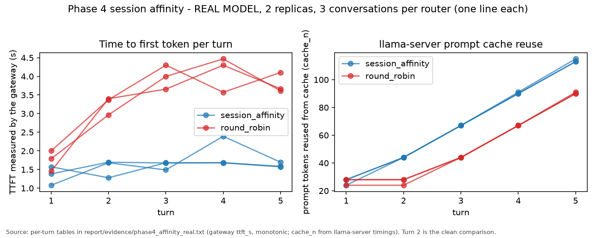
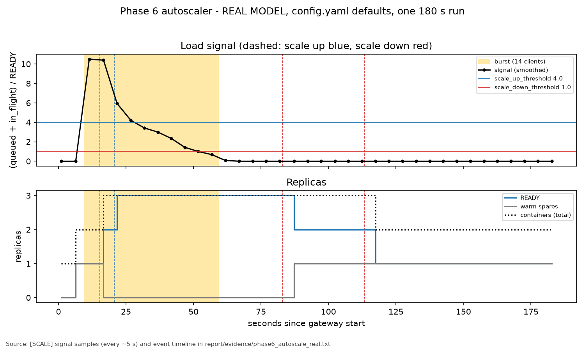
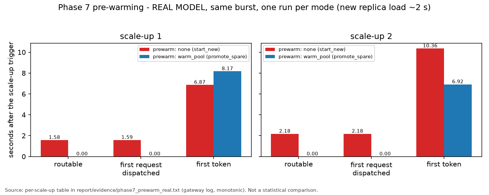

# Elastic LLM Inference Gateway - Final Report

A gateway that serves a small LLM (Qwen2.5-0.5B-Instruct, llama.cpp) from a pool of Docker
replicas on one machine, with request scheduling, routing, session affinity, fault tolerance,
autoscaling with a warm pool, and configuration switching without a restart. The design was frozen
in `ARCHITECTURE.md` (Phase 0) and built in nine further phases; every result below comes from
committed evidence of a real-model run on the demo machine unless it is marked simulated.

## 1. Problem

An LLM replica on a CPU is slow and has a fixed number of parallel slots. Sending requests to it
directly gives no control over who waits, where a conversation runs, what happens when a replica
dies, or how many replicas exist. The gateway sits in front of the replicas and makes those
decisions explicitly, logs each one, and can change its policies at run time.

## 2. Architecture (frozen, ARCHITECTURE.md section 2)

One Python process (FastAPI + asyncio) and N llama.cpp containers; no database or broker.

```
client --SSE--> POST /v1/chat/completions --> central queue (Scheduler) --> dispatch loop
                                                                              | only when a slot is free
                         Router (round_robin | least_busy | session_affinity) v
          ReplicaPool <-- ReplicaManager (Docker Engine API) <-- Autoscaler (+ warm pool)
               ^-- HealthMonitor (probes, DEAD, replacement)
```

| Component | File | Role |
|---|---|---|
| Contracts | `gateway/interfaces.py` | Request, Replica, Config, EventLog, abstract components, registries |
| Gateway / dispatch | `gateway/main.py` | HTTP API, central queue, dispatch loop, streaming, retries, sessions, reload |
| Scheduler | `gateway/scheduler.py` | `fcfs`, `spf_aging` |
| Router | `gateway/router.py` | `round_robin`, `least_busy`, `session_affinity` |
| Replica manager | `gateway/replica_manager.py` | containers with `--cpus` / `--memory`, readiness, drain, removal |
| Health monitor | `gateway/health.py` | `/health` probes, DEAD marking, replacement |
| Autoscaler | `gateway/autoscaler.py` | load signal, scale up/down, warm pool |
| Logging | `gateway/logging_conf.py` | one line per event, tags SCHED/ROUTE/SCALE/HEALTH, monotonic `mono=` |
| Load generator | `loadgen/burst.py` | deterministic burst / session workloads |

Key rule (decision 1): requests wait only in the gateway's queue and are dispatched only to a free
slot, so the scheduler alone decides who goes next and the router alone decides where.

## 3. Mechanisms

**Scheduling (Phase 3).** `fcfs` serves in arrival order. `spf_aging` serves the lowest
`priority = prompt_tokens - aging_alpha x wait_s` (prompt length estimated as characters / 4).
Aging bound, stated precisely: a long request outranks every shorter request that arrives more than
`(p_long - p_short) / alpha` seconds after it; it still waits for those that arrived before that point.

**Routing (Phase 2).** `round_robin` takes routable replicas in turn; `least_busy` picks the lowest
in-flight / slots. **Session affinity (Phase 4):** with a `session_id`, the gateway keeps the whole
conversation (clients send only the new message) and `session_affinity` keeps the session on one
replica while it is routable, otherwise falls back to least_busy and re-maps; the history is
replayed, so answers never depend on one replica's cache.

**Fault tolerance (Phase 5).** Probes every `health_interval_s`; `health_fail_limit` failures, or a
broken stream, mark a replica DEAD. Its in-flight requests go back to the front of the queue
(at most `max_retries`), the container is removed and a replacement started. On a retry the gateway
compares the regenerated tokens with what the client already has (greedy decoding, assumption #6),
skips them and continues the stream; if they differ the client gets an `llmgw_retry` event and the
output restarts.

**Autoscaling and warm pool (Phases 6-7).** Signal = (queued + in_flight) / READY replicas,
smoothed every 1 s. Scale up when above `scale_up_threshold` for `scale_up_after_s` (promote a warm
spare if there is one, else start a container); scale down by draining an idle replica when below
`scale_down_threshold` for `scale_down_cooldown_s`. With `prewarm: warm_pool`, `warm_pool_size`
loaded-but-unroutable spares are kept (started under load or at idle). Spares count toward
`max_replicas` (my reading of decision 12; the frozen text does not say).

**Configuration reload and load generator (Phase 8).** `POST /admin/reload` re-reads the config
file, validates all of it first (invalid file: HTTP 400, nothing changes), then applies it in one
synchronous step; the scheduler/router are rebuilt when their setting changed and queued requests
(retries first) move to the new scheduler. `loadgen/burst.py` sends deterministic workloads and
records client-side timings.

## 4. Defaults and their justification with measured data (Phase 10 criterion)

Defaults are those in `gateway/config.yaml`. "Supported" means the measurements back the choice
for this machine and workload; every condition was measured once.

| Default | Measured evidence | Verdict |
|---|---|---|
| `replica_cpus: 1.0`, `max_replicas: 3`, `min_replicas: 1` | 3 x 1 CPU <= 16 cores (decision 12). One replica's aggregate throughput rose only from 3.4 to 4.5 chunks/s from 1 to 3 concurrent requests (Fig. 1), so capacity comes from more replicas, not more parallel requests per replica. | Supported |
| `slots_per_replica: 2` | 1 -> 2 concurrent requests raised aggregate throughput 3.4 -> 4.2 chunks/s; a third concurrent request waited 58 s for a slot (Fig. 1). | Supported (small gain) |
| `scheduler: spf_aging`, `aging_alpha: 5.0` | Short requests waited 3.7-7.3 s under spf_aging vs 7.9-10.8 s under fcfs; the long request waited 10.2 s vs 5.2 s. Under overload, aging let the long request overtake later short ones (24.5 s) while without aging it was served last (27.3 s) (Fig. 2). | Supported for mixed prompt lengths; trades long-request wait for short-request wait |
| `router: least_busy` | In the real Phase 2 run least_busy and round_robin made identical choices (replicas filled evenly); their difference is shown only by the stand-in run and tests. No measured performance advantage. | Not justified by measured performance; behaviourally correct |
| `session_affinity` (not the default) | Turn-2 TTFT 1.553 s vs 3.247 s under round robin (3 conversations each), prompt-cache reuse 44 vs 24-28 tokens (Fig. 3). | Beneficial for multi-turn sessions; the default router does not enable it |
| `scale_up_threshold 4.0`, `scale_down_threshold 1.0`, `scale_up_after_s 5`, `scale_down_cooldown_s 30` | One 180 s run: 2 scale-ups during the burst, 2 drains after it, no flapping, never above 3 containers (Fig. 5). | Supported for this burst |
| `prewarm: warm_pool`, `warm_pool_size: 1` | Removes the model-load wait from a scale-up: first request on the new replica after 0.00 s vs 1.59 / 2.18 s with `none` (Fig. 6). But decision 8 assumed model load is the dominant scale-up delay; measured load was ~2 s, against the 5 s scale-up window and 6.9-10.4 s to the new replica's first token. Client-latency effect inconclusive (one run per mode). Costs one idle loaded container. | Weak: mechanism works, overall benefit not established |
| `health_interval_s 1.5`, `health_fail_limit 3` | Killed replica detected in 0.46-0.66 s (broken stream), frozen replica in 7.55-7.77 s (probes); replacement READY 2.25-2.44 s after detection (Fig. 4). | Supported; frozen-replica detection is the slow case |
| `max_retries: 2`, `default_temperature: 0.0` | All 8 retried requests (4 runs) completed on their first retry. Every regenerated prefix matched what the client had (21-27 tokens in run 2), but one prompt's final text differed from a fault-free run in 3 of 4 runs. | Retry path supported; exact greedy reproducibility not |

## 5. Experimental setup

- Machine: Windows 11 laptop, WSL2 Ubuntu 24.04 (16 cores, 7.6 GiB visible), Docker Engine 29.1.3.
- Model and image: Qwen2.5-0.5B-Instruct Q4_K_M GGUF, `ghcr.io/ggml-org/llama.cpp:server`;
  each replica `--cpus 1 --memory 1g`, `-np` = slots, `-c` = slots x 2048, `--cont-batching`.
- Workloads: the demo scripts in `scripts/` (bursts of 4-18 concurrent or spaced requests, 3x5-turn
  conversations, `docker kill` / `docker pause` faults, a 14-client autoscaling burst).
- **Real versus simulated:** every demo was also run with a stand-in replica image (no model,
  fixed 2 s "load", 20 tokens/s), labelled `SIMULATED` under `report/evidence/simulated/`. Stand-in
  runs only check gateway behaviour; none of their numbers appear in this report.

## 6. Results (real model, `report/phase9_measurements.md` for details)


Fig. 1 - One replica: model load 2.97 s; aggregate 3.4 / 4.2 / 4.5 chunks/s at 1 / 2 / 3 concurrent requests.


Fig. 2 - fcfs vs spf_aging, aging vs no aging; wait of the long request 5.25 / 10.22 / 24.50 / 27.28 s.


Fig. 3 - Turn-2 TTFT 1.553 s (affinity) vs 3.247 s (round robin), 3 conversations each.


Fig. 4 - Detection and replacement after `docker kill` / `docker pause`, two runs; all clients completed.


Fig. 5 - Scale up at 15.4 / 20.7 s, down at 82.9 / 113.4 s; no flapping.


Fig. 6 - Trigger to first request on the new replica: 1.59 / 2.18 s (none) vs 0.00 / 0.00 s (warm_pool).

Configuration switching (Phase 8, behaviour, real model): in one gateway process, a reload changed
the service order (long request first under fcfs, last under spf_aging), the placement of a
4-turn session (r1 r2 r1 r2 -> r1 r1 r1 r1) and the warm pool (none -> spare loaded in 1.94 s); an
invalid file was rejected (HTTP 400) and the old settings stayed in force.

## 7. Limitations and conclusions not supported

- One run per condition (Phase 4: 3 conversations per router within one run). Requests inside a
  run are not independent repetitions; **no statistical significance is claimed**.
- **The warm pool's benefit is not conclusively established**: it hides ~2 s of model load, but
  first-token time on the new replica was mixed and the burst-level difference is larger than the
  load time it hid.
- **Raw gateway logs were not retained** for every experiment: Phases 4, 6 and 7 are plotted from
  tables the demo scripts computed from the logs; Phase 1 from the feasibility script (wall clock).
- **Phase 6** signal values are ~5 s samples, so plotted changes lag events by up to 5 s.
- **Phase 7** client latency exists only as aggregates (mean / median / max), not per request.
- Model load was measured with the model file in the page cache; a cold load was not measured.
- Throughput is counted in streamed chunks (about one token each), not model tokens.
- **Results apply only to this machine, model, image and these workloads.**

## 8. Deviations from the frozen document (documented here; ARCHITECTURE.md not edited)

- Decision 4's aging bound is a crossover bound, not a bound on total wait (Phase 3 notes).
- Decision 8's premise (model load dominates scale-up delay) is not supported by the measurements.
- Decision 10: scheduler / router are rebuilt only when their setting changes (keeps affinity state).
- Decision 11: config reloads are logged with a fifth tag, `CONFIG`.
- Spares count toward `max_replicas`.
- Additions outside the frozen layout: `tests/` (with the stand-in replica image), per-phase check
  scripts (`phase1/2/6_*_check.sh`), `requirements.txt`, `LLMGW_CONFIG` / `LLMGW_LOG_FILE`, the
  `mono=` log field, the `session_id` request field and the `llmgw_retry` stream event.

## 9. Reproduction

On a Linux host with Docker (here WSL2 Ubuntu), from the project root:

```
python3 -m venv ~/llmgw-venv && source ~/llmgw-venv/bin/activate && pip install -r requirements.txt
bash scripts/check_feasibility.sh        # downloads the model, pulls the image, measures one replica
python -m pytest tests -v                # 104 tests, stand-in containers only (~4 min)
uvicorn gateway.main:app --port 8000     # the gateway with gateway/config.yaml
bash scripts/run_all_demos.sh real       # every phase demo with the real model (~25 min)
bash scripts/run_all_demos.sh standin    # the same with the stand-in image (simulated)
python report/measure.py                 # plots + measurements.json from the committed evidence
```

`run_all_demos.sh` runs the unchanged demo scripts in an isolated temporary copy of the project, so
committed evidence is never overwritten; `run_all_demos.sh real DIR` keeps that run's outputs in DIR.

## 10. Final dry runs (Phase 10)

`scripts/run_all_demos.sh real` was run twice from a clean state on the demo machine. Both runs
passed all 8 demos (107 checks each, 0 failures, exit 0, about 14 minutes each), left no
containers, processes or temporary files, and did not change any evidence file. The dry runs are
rehearsals: their outputs are discarded and are not used as measurements. Details, commands and
the console logs: `report/dry_runs/DRY_RUNS.md`.
