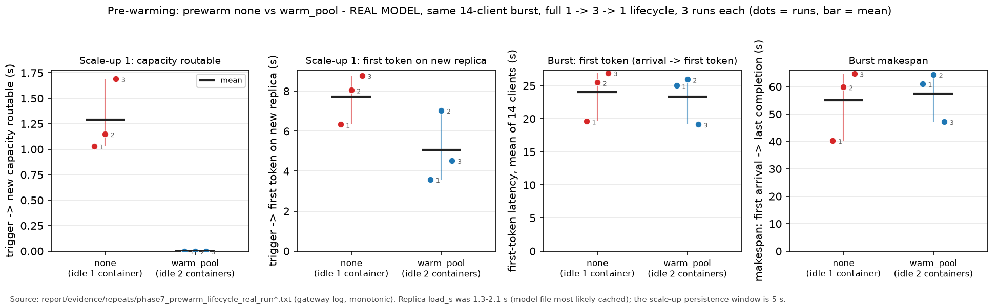
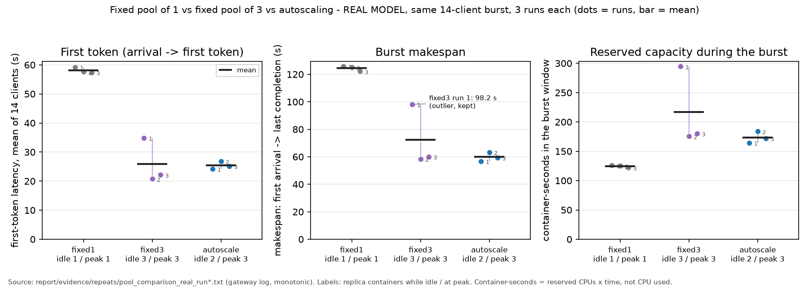
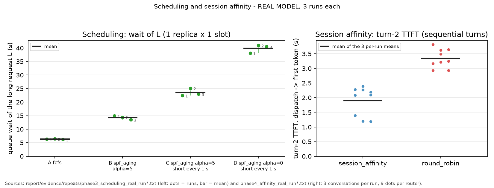
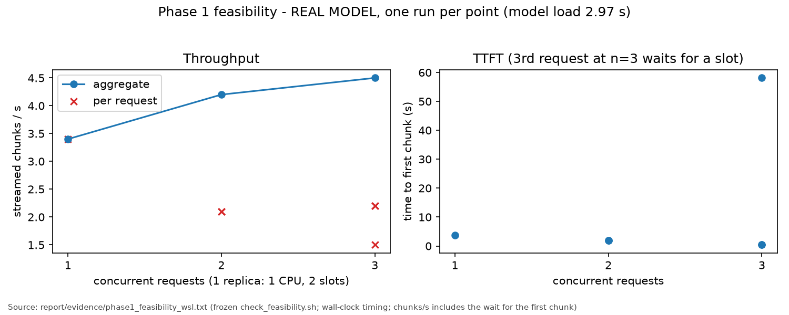
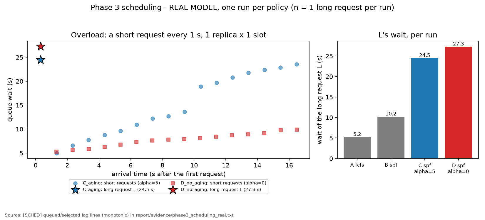
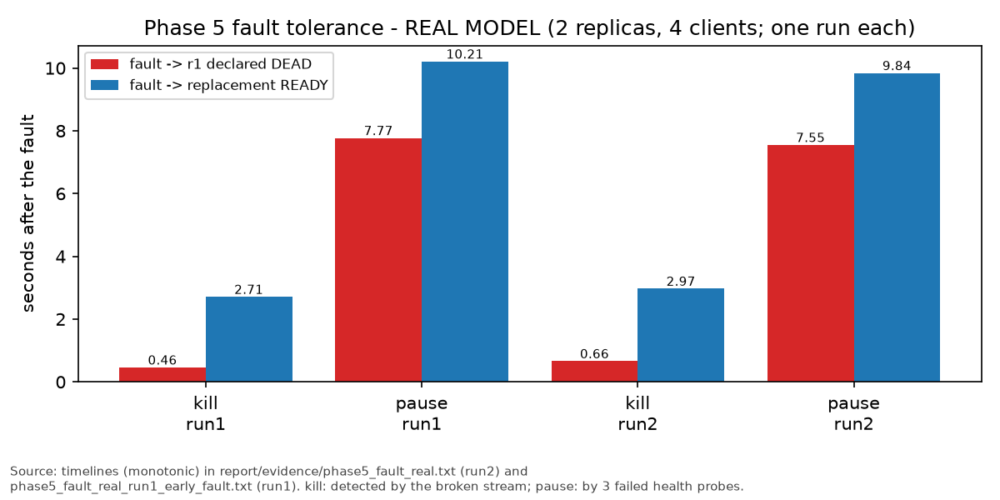

# Elastic LLM Inference Gateway - Final Report

A gateway that serves a small LLM (Qwen2.5-0.5B-Instruct, llama.cpp) from a pool of Docker
replicas on one machine, with request scheduling, routing, session affinity, fault tolerance,
autoscaling with a warm pool, and configuration switching without a restart. The design was frozen
in `ARCHITECTURE.md` (Phase 0) and built in nine further phases. Every result below comes from
committed evidence of real-model runs on the demo machine; simulated (stand-in) runs check
behaviour only and none of their numbers appear here. The key comparisons were repeated three
times (section 6.1); the remaining measurements are single runs and are labelled as such (6.2).

## 1. Problem

An LLM replica on a CPU is slow and has a fixed number of parallel slots. Sending requests to it
directly gives no control over who waits, where a conversation runs, what happens when a replica
dies, or how many replicas exist. The gateway sits in front of the replicas and makes those
decisions explicitly, logs each one, and can change its policies at run time.

## 2. Architecture (frozen, ARCHITECTURE.md section 2)

One Python process (FastAPI + asyncio) and N llama.cpp containers; no database or broker.

```
client --SSE--> POST /v1/chat/completions --> central queue (Scheduler) --> dispatch loop
                                                                              | only when a slot is free
                         Router (round_robin | least_busy | session_affinity) v
          ReplicaPool <-- ReplicaManager (Docker Engine API) <-- Autoscaler (+ warm pool)
               ^-- HealthMonitor (probes, DEAD, replacement)
```

| Component | File | Role |
|---|---|---|
| Contracts | `gateway/interfaces.py` | Request, Replica, Config, EventLog, abstract components, registries |
| Gateway / dispatch | `gateway/main.py` | HTTP API, central queue, dispatch loop, streaming, retries, sessions, reload |
| Scheduler | `gateway/scheduler.py` | `fcfs`, `spf_aging` |
| Router | `gateway/router.py` | `round_robin`, `least_busy`, `session_affinity` |
| Replica manager | `gateway/replica_manager.py` | containers with `--cpus` / `--memory`, readiness, drain, removal |
| Health monitor | `gateway/health.py` | `/health` probes, DEAD marking, replacement |
| Autoscaler | `gateway/autoscaler.py` | load signal, scale up/down, warm pool |
| Logging | `gateway/logging_conf.py` | one line per event, tags SCHED/ROUTE/SCALE/HEALTH, monotonic `mono=` |
| Load generator | `loadgen/burst.py` | deterministic burst / session workloads |

Key rule (decision 1): requests wait only in the gateway's queue and are dispatched only to a free
slot, so the scheduler alone decides who goes next and the router alone decides where.

**Static versus dynamic infrastructure.** `docker-compose.yml` runs the static part, the gateway
itself, as one Compose service (image `gateway/Dockerfile`). Replicas are not Compose services: the
gateway creates, drains and removes them at run time through the Docker Engine API, because their
number changes with load. The gateway container mounts the Docker socket (sibling containers, not
Docker-in-Docker), mounts the project at the same absolute path so `models_dir` resolves to a host
path the daemon can bind-mount, and uses host networking to reach replicas on the `llmgw-net`
bridge exactly as when it runs on the host. Verified with the real model: `docker compose up`
started the gateway, which started a replica and a warm spare and served a streamed request;
`docker compose down` removed every replica container.

## 3. Mechanisms

**Scheduling (Phase 3).** `fcfs` serves in arrival order. `spf_aging` serves the lowest
`priority = prompt_tokens - aging_alpha x wait_s` (prompt length estimated as characters / 4).
Aging bound, stated precisely: a long request outranks every shorter request that arrives more than
`(p_long - p_short) / alpha` seconds after it; it still waits for those that arrived before that point.

**Routing (Phase 2).** `round_robin` takes routable replicas in turn; `least_busy` picks the lowest
in-flight / slots. **Session affinity (Phase 4):** with a `session_id`, the gateway keeps the whole
conversation (clients send only the new message; a turn enters the history only when it
completes) and `session_affinity` keeps the session on one replica while that replica is routable
(READY with a free slot); if it is busy, draining or gone, the request falls back to least_busy and
the session is re-mapped. Requests without a `session_id` are routed least_busy. The history is
replayed, so answers never depend on one replica's cache.

**Fault tolerance (Phase 5).** Probes every `health_interval_s`; `health_fail_limit` failures, or a
broken stream, mark a replica DEAD. Its in-flight requests go back to the front of the queue
(at most `max_retries`; after that the client receives an error event), the container is removed
and a replacement started. On a retry the gateway
compares the regenerated tokens with what the client already has (greedy decoding, assumption #6),
skips them and continues the stream; if they differ the client gets an `llmgw_retry` event and the
output restarts. A replica whose container exits, or that never answers `/health`, while still
loading is removed (container and pool entry) and, if it was not a spare and the pool is below
`min_replicas`, replaced (a failed spare is left to the warm-pool logic);
after 3 consecutive load failures replacement stops, so a bad image or model path cannot cause an
endless start/die loop. A crash of a background task (dispatch loop, health monitor, autoscaler)
is logged at ERROR with its traceback.

**Autoscaling and warm pool (Phases 6-7).** Signal = (queued + in_flight) / READY replicas,
smoothed every 1 s. Scale up when above `scale_up_threshold` for `scale_up_after_s` (promote a warm
spare if there is one, else start a container, at most one start at a time); scale down when below
`scale_down_threshold` for `scale_down_cooldown_s` and more than `min_replicas` are READY, by
draining the least-loaded READY replica (no new requests; in-flight ones may finish for up to 30 s,
then the container is stopped). With `prewarm: warm_pool`, `warm_pool_size`
loaded-but-unroutable spares are kept (started under load or at idle). Spares count toward
`max_replicas` (my reading of decision 12; the frozen text does not say).

**Configuration reload and load generator (Phase 8).** `POST /admin/reload` re-reads the config
file, validates all of it first (invalid file: HTTP 400, nothing changes), then applies it in one
synchronous step; the scheduler/router are rebuilt when their setting changed and queued requests
(retries first) move to the new scheduler. `loadgen/burst.py` sends deterministic workloads and
records client-side timings.

## 4. Experimental setup and methodology

**Machine and replicas.** Windows 11 laptop, WSL2 Ubuntu 24.04 (16 cores, 7.6 GiB visible), Docker
Engine 29.1.3. Qwen2.5-0.5B-Instruct Q4_K_M GGUF in `ghcr.io/ggml-org/llama.cpp:server`; each
replica `--cpus 1 --memory 1g`, `-np` = slots, `-c` = slots x 2048, `--cont-batching`.
Configuration = `gateway/config.yaml`; each experiment changes only the keys under comparison. The
pre-warming and pool scripts print each condition's configuration and check that only the compared
keys differ; the scheduling and affinity scripts set the compared keys explicitly.

**Workloads.**

| Experiment | Script | Workload |
|---|---|---|
| Pre-warming lifecycle (6.1.1) | `scripts/demo3_prewarm.sh` | fresh gateway, 1 replica READY, 15 s idle, burst of 14 concurrent streamed clients (`max_tokens` 40), then idle until the pool is back at `min_replicas`; once with `prewarm: none`, once with `warm_pool` |
| Pool baseline (6.1.2) | `scripts/compare_pools.sh` | the same burst after `min_replicas` are READY and 15 s idle; fixed1 (`min = max = 1`), fixed3 (`min = max = 3`), both `prewarm: none`; autoscale (`config.yaml` unchanged: min 1, max 3, warm pool) |
| Scheduling (6.1.3) | `scripts/demo1_scheduling.sh` | 1 replica x 1 slot; A/B: a blocker, a long request L, 4 short requests 0.3 s apart (fcfs vs spf_aging); C/D: a blocker, L, then a short request every 1 s, 16 in all (spf_aging with alpha 5 vs 0) |
| Session affinity (6.1.4) | `scripts/demo2_affinity.sh` | 2 replicas; 3 conversations x 5 turns sent strictly one after another with a `session_id`, `max_tokens` 12; session_affinity vs round_robin |

**Metrics.** All times come from the gateway log's monotonic `mono=` field.
*First token (6.1.1, 6.1.2)* is measured from the request's arrival in the gateway queue to its
first token, so it includes queue wait. *Turn-2 TTFT (6.1.4)* is the gateway's `ttft_s`, measured
from dispatch to the replica until the first token, so it excludes queue wait; in that
sequential workload the queue is empty, so the difference is small, but the two metrics are not
the same and are never compared with each other. *Makespan* is first arrival to last completion. *Wait (6.1.3)* is time in the gateway queue, from
arrival to selection by the scheduler (the scheduler's logged `wait_s`); it excludes service time.
*load_s* is the time from just before `docker run` until the replica's `/health` returns 200;
readiness is polled every 0.5 s, so load_s and "routable" times have up to ~0.5 s resolution.
*Container-seconds* is replica containers alive x time in the burst window, i.e. CPU reserved
(1 CPU each), not CPU used.

**Repetition and aggregation.** The four experiments above were run 3 times each (12 runs,
2026-11-10, 19:59-20:38 UTC). The runs were sequential: each round ran the four scripts one after
another, so the rounds interleave the experiments and slow drift of the host affects all of them.
Each round used a fresh copy of the project without `report/evidence/`, so no committed evidence
could be overwritten, and before every script the runner checked that no replica container was
left and port 8000 was free (never violated). All 12 runs completed with 0 failed checks; none
was repeated or discarded. `report/aggregate_repeats.py` parses the 12 unedited output files
(`report/evidence/repeats/*_real_run<k>.txt`) and prints, per metric, the 3 per-run values, their
mean and their range (min-max) to `report/evidence/repeats/SUMMARY.txt`; the same parsed values
draw Figs. 1-3. With n = 3, means and ranges are descriptive; no significance test is used and
none is claimed. Overlapping ranges are read as "no measurable difference in these runs".

**Real versus simulated.** Every demo was also run with a stand-in replica image (no model, fixed
2 s "load", 20 tokens/s), labelled `SIMULATED` under `report/evidence/simulated/`. Stand-in runs
only check gateway behaviour; none of their numbers appear in this report.

## 5. Default configuration and its justification

Defaults are those in `gateway/config.yaml`. They are reasonable engineering choices for this
machine and these workloads, not measured optima: no parameter was swept.

| Default | Evidence | Trade-off and reason |
|---|---|---|
| Autoscaling, `min_replicas 1`, `max_replicas 3`, `replica_cpus 1.0` | 6.1.2: autoscale's mean first-token latency (25.40 s) was close to fixed3 (25.91 s) and less than half of fixed1 (58.09 s); it held 2 containers while idle instead of 3. 3 x 1 CPU fits 16 cores (decision 12). | Fixed capacity is ready before a burst and was faster to first token in 2 of 3 runs; autoscaling releases capacity when idle. With this burst, autoscaling gave comparable latency for less idle capacity. |
| `scale_up_threshold 4.0`, `scale_up_after_s 5`, `scale_down_threshold 1.0`, `scale_down_cooldown_s 30` | 6 lifecycle runs (6.1.1) and the Phase 6 run: 1 -> 3 replicas during the burst, drained back to 1 afterwards, no flapping. | Separate thresholds and timers prevent oscillation at the cost of reacting about 5 s late to a burst and holding extra replicas after it (first released 22-30 s, back at `min_replicas` 53-61 s after the last request). |
| `prewarm: warm_pool`, `warm_pool_size 1` | 6.1.1: the spare is routable at the trigger (0.00 s vs 1.29 s) and the new replica's first token came earlier (5.05 vs 7.72 s), but burst-level first-token latency and makespan did not differ measurably. | Readiness against idle cost: one extra loaded container (1 CPU / 1 GiB reserved) at all times. Kept as the default because it removes load time from the scale-up path, which is expected to matter more when replica load is slow (larger models, uncached files; not measured here); on this host, with a ~1.3-2.1 s cached load, `prewarm: none` is an equally defensible choice. |
| `slots_per_replica 2` | Phase 1 (single run): aggregate throughput 3.4 -> 4.2 -> 4.5 chunks/s at 1 / 2 / 3 concurrent requests; a third request waited 58 s for a slot. | Small throughput gain from a second slot; more slots per 1-CPU replica add little, so capacity comes from more replicas. |
| `scheduler: spf_aging`, `aging_alpha 5.0` | 6.1.3: short requests waited 8.65 s (spf_aging) vs 13.11 s (fcfs), the long request 14.28 vs 6.31 s; under overload aging served L after 9 short requests instead of last (23.50 vs 39.83 s), identically in all 3 runs. | Favours short prompts and bounds the long request's wait through aging; fcfs is fairer to arrival order. Not better in general: it trades long-request wait for short-request wait. |
| `router: least_busy` | Phase 2 (single run): least_busy and round_robin made identical choices when replicas filled evenly; no measured performance advantage. | Behaviourally sound for unequal loads, and it is also what session_affinity uses for requests without a `session_id`. |
| `session_affinity` (not the default) | 6.1.4: turn-2 TTFT 1.90 s vs 3.34 s with round robin for sequential conversations. | Recommended when clients send `session_id`. Not the default because it was measured only with sequential conversations; its effect with many concurrent sessions was not measured. |
| `health_interval_s 1.5`, `health_fail_limit 3`, `max_retries 2`, `default_temperature 0.0` | Phase 5 (2 runs): killed replica detected in 0.46-0.66 s (broken stream), frozen replica in 7.55-7.77 s (probes); replacement READY 2.25-2.44 s after detection; all 8 retried requests completed on their first retry. | Faster probing would detect frozen replicas sooner at more probe traffic. Greedy decoding makes prefix verification possible, but the final text of one prompt still differed from a fault-free run in 3 of 4 runs, so exact reproducibility is not guaranteed. |

## 6. Results (real model)

### 6.1 Repeated measurements (3 runs each; mean, range in brackets)

#### 6.1.1 Pre-warming over the full lifecycle: `prewarm: none` vs `warm_pool`


Fig. 1 - Pre-warming, 3 runs per mode. Dots are runs (numbered), bars are means.

| Metric | none | warm_pool |
|---|---|---|
| First scale-up: trigger -> new capacity routable | 1.29 s [1.03-1.69] | 0.00 s in all runs |
| First scale-up: trigger -> first token on the new replica | 7.72 s [6.33-8.78] | 5.05 s [3.58-7.04] |
| load_s of that replica | 1.64 s [1.33-2.09] | 2.02 s [1.98-2.04], loaded before it was needed |
| Burst: first-token latency, mean of 14 clients | 24.00 s [19.61-26.93] | 23.37 s [19.16-25.94] |
| Burst: completion latency, mean of 14 clients | 38.43 s [29.89-44.57] | 38.55 s [31.04-42.33] |
| Burst makespan | 54.95 s [40.26-64.71] | 57.51 s [47.20-64.34] |
| Last completion -> back at `min_replicas` READY | 56.40 s [53.97-61.16] | 56.54 s [52.87-59.74] |
| Replica containers while idle | 1 | 2 (r1 + re-armed spare) |

In all 6 runs the pool went 1 -> 3 -> 1 READY replicas: two scale-ups during the burst, two drained
scale-downs afterwards, no scale-up after the first scale-down, and in `warm_pool` the spare was
re-armed at the end. **The warm pool reduced replica start-up delay on the scale-up path, but it
did not show a robust end-to-end improvement for the burst.** The new capacity was routable at the
trigger instead of ~1.3 s later, and the new replica's first token came earlier in each of the 3
pairs. The committed single Phase 7 run had the opposite sign for that measure (none 6.87 s,
warm_pool 8.17 s), so over 4 runs warm_pool was lower in 3. Burst-level first-token latency,
completion latency and makespan overlap almost completely. A replica loads in ~1.3-2.1 s here,
while the 5 s persistence window (`scale_up_after_s`) and queueing behind 2 slots per replica
dominate what clients wait for; with cached model loads, decision 8's premise (model load dominates
scale-up delay) therefore does not hold on this host. The cost of the warm pool is one additional loaded container
held whenever the system is idle.

#### 6.1.2 Baseline: fixed pool of 1 vs fixed pool of 3 vs autoscaling


Fig. 2 - Same 14-client burst, 3 runs per pool. The fixed3 run 1 outlier is shown and included.

| Metric | fixed1 | fixed3 | autoscale |
|---|---|---|---|
| First-token latency, mean of 14 clients | 58.09 s [57.39-59.24] | 25.91 s [20.74-34.83] | 25.40 s [24.22-26.85] |
| First-token latency, max | 110.21 s [108.56-111.97] | 54.03 s [44.35-72.45] | 44.89 s [42.98-47.23] |
| Completion latency, mean | 72.84 s [71.74-74.27] | 48.55 s [38.25-66.03] | 41.82 s [38.69-44.38] |
| Makespan | 124.38 s [122.17-125.88] | 72.25 s [58.50-98.18] | 59.84 s [56.79-63.35] |
| Replica containers while idle / at peak | 1 / 1 | 3 / 3 | 2 / 3 |
| Container-seconds in the burst window | 124.4 [122.2-125.9] | 216.7 [175.5-294.5] | 173.5 [164.4-183.9] |

- A single replica (2 slots) gave about 2-2.8x the makespan and first-token latency of
  autoscaling in every run, and of fixed3 in runs 2 and 3; against the anomalous fixed3 run 1 the
  ratios were 1.3x (makespan) and 1.7x (first token).
- **Fixed3 run 1 is anomalous**: every latency in that run was ~1.6x its runs 2 and 3 values
  (makespan 98.18 s vs 58.50 / 60.06 s), although its routing (6/4/4 requests per replica) and
  replica load times (1.46-1.95 s) were normal. The demo scripts do not keep raw gateway logs, so
  the cause could not be identified; host interference is plausible but not shown. The run is kept
  in every mean and range.
- **Trade-off.** For this workload, autoscaling achieved first-token performance comparable to a
  permanently provisioned pool of 3 (means 25.40 vs 25.91 s), with fewer containers held idle (2
  vs 3) and a lower observed mean makespan (59.84 vs 72.25 s). The makespan difference is driven
  by the fixed3 outlier: in runs 2 and 3 fixed3's makespan (58.50, 60.06 s) lay within
  autoscale's range, and its first-token mean (20.74, 22.17 s) was lower than autoscale's in every
  run, because its capacity exists before the burst. A burst arriving faster than the 5 s scale-up
  window, or a longer one, could change this balance.

#### 6.1.3 Scheduling


Fig. 3 - Left: wait of the long request L per scheduling run. Right: turn-2 TTFT, 9 conversations per router.

| Run | Policy | Wait of L | Mean wait of short requests | Service order |
|---|---|---|---|---|
| A | fcfs | 6.31 s [6.20-6.43] | 13.11 s [11.80-14.16] | arrival order, all 3 runs |
| B | spf_aging, alpha 5 | 14.28 s [13.51-14.90] | 8.65 s [8.25-9.45] | all short requests before L, all 3 runs |
| C | spf_aging, alpha 5, overload | 23.50 s [22.43-25.12] | 14.72 s [13.77-16.52] | 9 short requests before L, 7 after, all 3 runs |
| D | spf_aging, alpha 0, overload | 39.83 s [38.07-40.95] | 13.68 s [12.34-14.37] | L last (after all 16), all 3 runs |

The service order was identical in all 3 runs of every scenario, and so was the aging crossover in
C: the 9 short requests that arrived within the 9.2 s crossover bound ((52 - 6) / 5) were served
before L and the 7 later ones after it; without aging (D) L was served last every time. Absolute
waits depend on host performance. Measured as the mean interval between consecutive scheduler
selections (the replica's time per request while the queue is non-empty), the replica was slower
in A, B and D than in the committed single Phase 3 run (2.61 / 1.96 / 2.06 s vs 1.70 / 1.55 /
1.31 s), and L waited longer (6.31 / 14.28 / 39.83 s vs 5.25 / 10.22 / 27.28 s); D grows most
because L waits for all 16 short requests. In C the time per request was similar (2.16 vs 2.11 s)
and so was L's wait (23.50 vs 24.50 s). The gateway's decisions were the same; the ranking of L's
wait (A < B < C < D) did not change.

#### 6.1.4 Session affinity (sequential conversations)

| | Turn-2 TTFT, per-run mean of 3 conversations |
|---|---|
| session_affinity | 1.90 s [1.26-2.22] |
| round_robin | 3.34 s [3.03-3.56] |
| Difference (round_robin - affinity) | 1.44 s [0.81-2.18] |

All 9 turn-2 requests per router: affinity 1.19-2.39 s, round robin 2.93-3.82 s; the ranges do not
overlap. In every run the affinity replica reused 44 prompt tokens from its cache on turn 2
against 24-28 under round robin. The committed single Phase 4 run (1.553 vs 3.247 s) lies within
these ranges. **This holds for the workload tested: one conversation at a time, turns sent one
after another, 2 replicas.** It does not show an advantage under concurrent load, where pinning
sessions can concentrate requests on one replica; that case was not measured.

### 6.2 Single-run measurements

These were measured once (Phase 5: two runs) and are not repeated results.


Fig. 4 - One replica: model load 2.97 s; aggregate 3.4 / 4.2 / 4.5 chunks/s at 1 / 2 / 3 concurrent requests.


Fig. 5 - Single Phase 3 run: queue wait of every request in the overload scenarios C and D, and L's wait in A-D.


Fig. 6 - Single Phase 4 run: TTFT and prompt-cache reuse for all 5 turns of each conversation.


Fig. 7 - Detection and replacement after `docker kill` / `docker pause`, two runs; all clients completed.


Fig. 8 - Single 180 s run: scale up at 15.4 / 20.7 s, down at 82.9 / 113.4 s; no flapping.

Configuration switching (Phase 8, behaviour, real model): in one gateway process, a reload changed
the service order (long request first under fcfs, last under spf_aging), the placement of a
4-turn session (r1 r2 r1 r2 -> r1 r1 r1 r1) and the warm pool (none -> spare loaded in 1.94 s); an
invalid file was rejected (HTTP 400) and the old settings stayed in force. The single-run Phase 7
figure (`plots/phase7_prewarm.png`) is superseded by Fig. 1 and kept only with the Phase 9 record
(`report/phase9_measurements.md`).

## 7. Limitations and threats to validity

- **Small n.** 3 runs per condition for the repeated experiments; Phases 1, 5, 6 and 8 are single
  runs (Phase 5: two). Requests inside a run are not independent repetitions. Means and ranges
  are descriptive; **no statistical significance is claimed**.
- **Uncontrolled host.** A Windows laptop running WSL2: background activity and power state were
  not controlled. Absolute times varied between sessions (6.1.3: up to ~1.6x longer per request
  than in the committed single run),
  and the 1-minute load average at script start ranged 0.02-5.15 (`run_log.txt`).
- **Order effects.** Within a round the order was always pre-warming -> pools -> scheduling ->
  affinity, and within the pool comparison fixed1 -> fixed3 -> autoscale.
- **Unexplained outlier.** Fixed3 run 1 (6.1.2) is ~1.6x slower than its other runs; raw gateway
  logs were not retained by the demo scripts, so outliers can be described but not diagnosed.
  Earlier phases are likewise plotted from tables the scripts computed from their logs at run time.
- **One workload shape per question.** The scaling comparisons use one 14-client burst; the
  affinity result covers sequential conversations only; results may not transfer to other loads.
- **Cold model load was not measured.** The cold-load measurement was skipped (it needs `sudo` to
  drop the page cache, and in WSL2 that clears only the Linux VM's cache), and the unrun
  `cold_load_check.sh` script was removed. All `load_s` values in this report were most likely
  measured with the model file already cached in memory, so they must not be read as verified
  cold-start times. This affects the interpretation of replica start-up (and therefore of the
  warm pool, whose benefit would grow with a slower load); it does not affect the scheduling,
  affinity or queueing measurements, which do not involve starting replicas.
- **Measurement details.** Phase 6 signal values are ~5 s samples; throughput (Phase 1) is counted
  in streamed chunks (about one token each) with the wall clock of the frozen feasibility script.
- **Thread count not matched to the CPU limit.** The replica command sets no `-t`; an inspection of
  one replica showed llama.cpp starting 8 threads under a 1-CPU quota
  (`report/evidence/replica_threads_real.txt`). Its effect on throughput and latency was not
  measured. All conditions used the same setting, so comparisons between them are like for like,
  but absolute per-replica numbers may differ from what a 1-thread setting would give.
- **Known implementation limits** (from reading the code; none occurred in the runs): the queue is
  unbounded, with no admission control (no 429/503); streams to replicas have no read timeout, so a
  replica that answers `/health` but stops generating would stall its clients; session histories
  are kept in memory without a bound and can outgrow the 2048-token context per slot, and
  concurrent turns of one session are not serialised; config validation checks types, the
  allowed `prewarm` values and `min_replicas <= max_replicas` but not, e.g., that the scale-down threshold is below the
  scale-up threshold.
- **Results apply only to this machine, model, image and these workloads.**

## 8. Deviations from the frozen document (documented here; ARCHITECTURE.md not edited)

- Decision 4's aging bound is a crossover bound, not a bound on total wait (Phase 3 notes).
- Decision 8's premise (model load dominates scale-up delay) is not supported by the measurements
  (cached loads; a cold load was not measured).
- Decision 7: draining waits for `in_flight == 0` for at most 30 s, then stops the container; a
  request still running then loses its stream and goes through the normal retry path (from the
  code; in every recorded scale-down the replica had drained, `drained=True`).
- Decision 10: scheduler / router are rebuilt only when their setting changes (keeps affinity state).
- Decision 11: config reloads are logged with a fifth tag, `CONFIG`.
- Spares count toward `max_replicas`.
- Docker Compose covers only the static gateway service (ARCHITECTURE.md section 1 lists the
  Compose plugin as "only needed for the static part of the setup"); replicas stay under Engine
  API control.
- Additions outside the frozen layout: `tests/` (with the stand-in replica image), per-phase check
  scripts (`phase1/2/6_*_check.sh`), `scripts/compare_pools.sh`, `report/aggregate_repeats.py`,
  `docker-compose.yml` with `gateway/Dockerfile`, `requirements.txt`, `LLMGW_CONFIG` /
  `LLMGW_LOG_FILE`, the `mono=` log field, the `session_id` request field, the `llmgw_retry` stream
  event, removal and bounded replacement of replicas that die while loading, and logging of
  crashed background tasks.

## 9. Reproduction

On a Linux host with Docker (here WSL2 Ubuntu), from the project root:

```
python3 -m venv ~/llmgw-venv && source ~/llmgw-venv/bin/activate && pip install -r requirements.txt
bash scripts/check_feasibility.sh        # downloads the model, pulls the image, measures one replica
python -m pytest tests -v                # 107 tests, stand-in containers (+ one using the llama.cpp image)
uvicorn gateway.main:app --port 8000     # the gateway with gateway/config.yaml
docker compose up -d --build             # or: the gateway as a Compose service (compose plugin needed)
bash scripts/run_all_demos.sh real       # every phase demo with the real model
bash scripts/run_all_demos.sh standin    # the same with the stand-in image (simulated)
bash scripts/compare_pools.sh real       # fixed1 / fixed3 / autoscale baseline (one run)
python report/measure.py                 # single-run plots + measurements.json from the committed evidence
python report/aggregate_repeats.py --plots > report/evidence/repeats/SUMMARY.txt   # repeated-run summary + Figs. 1-3
```

`run_all_demos.sh` runs the unchanged demo scripts in an isolated temporary copy of the project, so
committed evidence is never overwritten; `run_all_demos.sh real DIR` keeps that run's outputs in DIR.
The recorded real dry runs took about 14 minutes each (section 10); demo 3 has since been extended
to the full scale-down lifecycle and now takes about 4 minutes on its own (246-250 s in the
repeated runs, against 144-163 s in the dry runs), so a full real run takes a few minutes longer.
The repeated runs were made by running the four scripts of section 4 three times in this way.

## 10. Final dry runs (Phase 10)

`scripts/run_all_demos.sh real` was run twice from a clean state on the demo machine, before
demo 3 was extended. Both runs passed all 8 demos (107 checks each, 0 failures, exit 0, about 14
minutes each), left no containers, processes or temporary files, and did not change any evidence
file. The dry runs are rehearsals: their outputs are discarded and are not used as measurements.
Details, commands and the console logs: `report/dry_runs/DRY_RUNS.md`.
